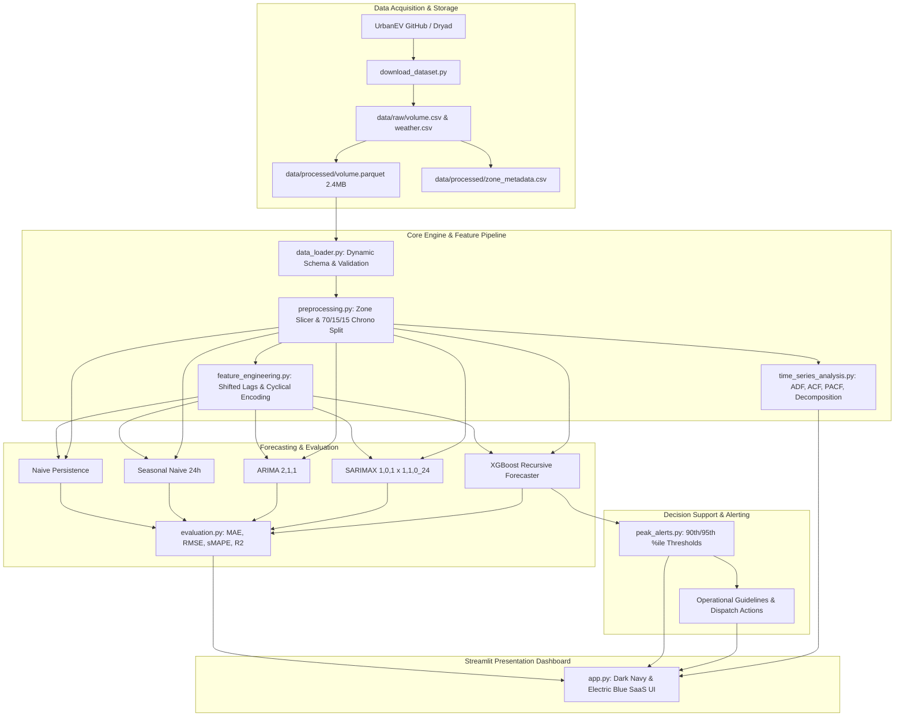

# EVision — Intelligent EV Charging Demand Forecasting & Peak Load Prediction System

[](https://www.python.org/)
[](https://streamlit.io/)
[](https://scikit-learn.org/)
[](https://creativecommons.org/publicdomain/zero/1.0/)

> **EVision** is an end-to-end, production-grade time series forecasting and operational intelligence platform designed for municipal utilities, Charging Point Operators (CPOs), and power grid distribution planners. Utilizing real empirical data from the official **UrbanEV** benchmark dataset (Shenzhen, China), EVision predicts zone-level electric vehicle charging demand, detects statistical peak loading periods, and provides automated operational recommendations.

---

## 📑 Table of Contents
1. [Project Overview & Problem Statement](#1-project-overview--problem-statement)
2. [Key Objectives](#2-key-objectives)
3. [Core Functional Modules](#3-core-functional-modules)
4. [Dataset Attribution & Description](#4-dataset-attribution--description)
5. [System Architecture](#5-system-architecture)
6. [Forecasting Methodology & Algorithms](#6-forecasting-methodology--algorithms)
7. [Model Evaluation & Leaderboard](#7-model-evaluation--leaderboard)
8. [Peak Demand Warning System](#8-peak-demand-warning-system)
9. [Technology Stack](#9-technology-stack)
10. [Local Installation & Setup](#10-local-installation--setup)
11. [Running the Application](#11-running-the-application)
12. [Running Tests](#12-running-tests)
13. [Limitations & Ethical Engineering Disclaimer](#13-limitations--ethical-engineering-disclaimer)
14. [Future Roadmap](#14-future-roadmap)
15. [References & Citations](#15-references--citations)

---

## 1. Project Overview & Problem Statement

The rapid global electrification of commercial transportation and private vehicles places immense, localized stress on electrical distribution networks. Electric Vehicle (EV) charging behavior is characterized by severe diurnal non-linearities, spatial concentration, and rapid charging spikes. 

Traditional naive estimation methods and static time-of-use tariffs fail to capture sudden localized demand shifts. **EVision** bridges the gap between raw empirical telemetry and grid dispatch operations by combining econometric time series analysis (ADF, ACF, PACF, SARIMA) with gradient-boosted machine learning (XGBoost Regressor) to forecast hourly demand across 275 administrative zones up to 48 hours in advance.

---

## 2. Key Objectives

- **High-Fidelity Forecasting:** Deliver hourly demand projections in kWh for individual zones or citywide aggregated load across 6, 12, 24, and 48-hour horizons.
- **Leak-Free ML Pipeline:** Construct autoregressive lags, shifted rolling statistics, calendar indicators, and cyclical trigonometric features without future target leakage.
- **Standardized Benchmarking:** Evaluate 5 distinct models across chronological 70/15/15 splits using MAE, RMSE, sMAPE, zero-handled MAPE, and $R^2$.
- **Proactive Peak Mitigation:** Detect periods exceeding historical 90th and 95th percentiles and synthesize actionable operational guidance (BESS discharge, tariff adjustments, driver navigation incentives).
- **Zero Hallucination / Real Data:** Built exclusively on verified empirical observations from the peer-reviewed UrbanEV benchmark.

---

## 3. Core Functional Modules

EVision is structured into seven primary operational views within a high-performance Streamlit SaaS interface:

1. **Overview Dashboard:** Executive KPI metric cards, recent vs. forecast trajectory, citywide load aggregations, top 10 zone rankings, and alert summaries.
2. **Data Exploration:** Diurnal 24h hourly profiles, weekday vs. weekend comparative curves, monthly trajectories, and geospatial scatter maps of 1,362 charging hubs.
3. **Time Series Diagnostics:** Augmented Dickey-Fuller (ADF) stationarity testing, first-order and seasonal differencing analysis, 4-panel classical additive/multiplicative decomposition, and ACF/PACF correlograms.
4. **Demand Forecasting:** Interactive scenario engine with configurable horizons (6h, 12h, 24h, 48h), model selection, peak demand callouts, and CSV export.
5. **Model Comparison:** Chronological validation leaderboard ranking all 5 models by MAE, side-by-side actual vs. predicted curves, and error distribution charts.
6. **Peak Demand Alerts:** Threshold detection for High Demand (>90th percentile) and Critical Peak (>95th percentile) with structured operations cards.
7. **About & Documentation:** Academic citations, mathematical formulations, and engineering limitations.

---

## 4. Dataset Attribution & Description

This system uses the official, peer-reviewed **UrbanEV** benchmark dataset collected across Shenzhen, China:

- **Source Paper:** *UrbanEV: A Benchmark Dataset for City-Scale Electric Vehicle Charging Demand Prediction*
- **Publication:** *Nature Scientific Data* (2025)
- **Primary Target (`volume.csv`):** Hourly EV charging volume measured in kilowatt-hours (kWh).
- **Timeframe:** September 1, 2022 to February 28, 2023 (181 days / 4,344 continuous hourly intervals).
- **Spatial Breadth:** 275 Traffic Analysis Zones (TAZs).
- **Infrastructure Scope:** 1,362 public charging stations and 17,532 charging piles.
- **Meteorology (`weather_central.csv`):** Synchronized hourly temperature (°C), atmospheric pressure, relative humidity (%), precipitation category, and dew point.
- **Infrastructure Metadata (`inf.csv`):** Station counts, charging pile capacity, geographic centroid coordinates (latitude/longitude), and zone surface area.

---

## 5. System Architecture



---

## 6. Forecasting Methodology & Algorithms

EVision implements five complementary forecasting models spanning naive baselines, classical statistical econometrics, and modern machine learning:

### 1. Naive Forecaster (Persistence)
$$\hat{y}_{t+h} = y_t$$
Establishes the minimal baseline: assumes future demand equals the most recent actual observation.

### 2. Seasonal Naive Forecaster (24h Diurnal)
$$\hat{y}_{t+h} = y_{t + h - 24}$$
Directly captures the strong 24-hour diurnal rhythm of urban EV charging without model parameters.

### 3. ARIMA (Autoregressive Integrated Moving Average)
$$\phi(B)(1 - B)^d y_t = \theta(B) \epsilon_t$$
Fitted with order $(p=2, d=1, q=1)$ to account for non-stationary trend drifts and autocorrelation in first differences.

### 4. SARIMAX (Seasonal ARIMA)
$$\Phi_P(B^s) \phi_p(B) (1 - B^s)^D (1 - B)^d y_t = \Theta_Q(B^s) \theta_q(B) \epsilon_t$$
Configured with order $(1, 0, 1) \times (1, 1, 0)_{24}$ to jointly capture short-term autoregression and cyclical 24-hour daily seasonality.

### 5. XGBoost Regressor (Recursive Multi-Step)
Gradient-boosted decision tree ensemble trained on an engineered, leak-free feature matrix:
- **Autoregressive Lags:** $y_{t-1}, y_{t-2}, y_{t-3}, y_{t-24}, y_{t-48}, y_{t-168}$
- **Shifted Rolling Window Stats:** 6-hour and 24-hour rolling mean and standard deviation (calculated over $y_{<t}$ using `shift(1)` to strictly prevent target leakage).
- **Calendar Identifiers:** Hour of day, day of week, weekend indicator, month.
- **Trigonometric Cyclical Encodings:**
  $$\text{hour}_{\sin} = \sin\left(\frac{2\pi \cdot \text{hour}}{24}\right), \quad \text{hour}_{\cos} = \cos\left(\frac{2\pi \cdot \text{hour}}{24}\right)$$
  $$\text{day}_{\sin} = \sin\left(\frac{2\pi \cdot \text{day}}{7}\right), \quad \text{day}_{\cos} = \cos\left(\frac{2\pi \cdot \text{day}}{7}\right)$$

---

## 7. Model Evaluation & Leaderboard

All evaluations adhere to strict temporal integrity:
- **Training Set (70%):** Sep 01, 2022 to Jan 05, 2023 (3,040 hours)
- **Validation Set (15%):** Jan 05, 2023 to Feb 01, 2023 (651 hours) — used for model selection
- **Test Set (15%):** Feb 01, 2023 to Feb 28, 2023 (653 hours) — held out for generalization verification

### Representative Benchmark (Zone 102 — 24-Hour Lookahead)

| Model | Validation MAE (kWh) | Validation RMSE (kWh) | sMAPE (%) | MAPE (kWh > 0.5) | Test MAE (kWh) |
|---|:---:|:---:|:---:|:---:|:---:|
| **XGBoost Regressor** | **6.87** | **8.41** | **12.71%** | **11.65%** | **4.79** |
| **SARIMAX** | 9.77 | 11.70 | 18.83% | 16.60% | 4.96 |
| **Seasonal Naive (24h)** | 10.48 | 15.07 | 19.63% | 18.74% | 6.15 |
| **ARIMA (2,1,1)** | 27.59 | 28.51 | 62.95% | 47.56% | 9.41 |
| **Naive (Persistence)** | 28.07 | 28.98 | 64.45% | 48.43% | 9.44 |

### Mathematical Metric Formulations
- **MAE:** $\frac{1}{n} \sum |y_i - \hat{y}_i|$
- **RMSE:** $\sqrt{\frac{1}{n} \sum (y_i - \hat{y}_i)^2}$
- **sMAPE:** $\frac{100\%}{n} \sum \frac{2 |y_i - \hat{y}_i|}{|y_i| + |\hat{y}_i| + \epsilon}$ (strictly bounded in $[0, 200\%]$; zero-resilient)
- **Zero-Handled MAPE:** Evaluated strictly on observations where $y_i > 0.5 \text{ kWh}$.

---

## 8. Peak Demand Warning System

EVision computes dynamic zone percentiles from historical data:
- **Normal Demand:** $\hat{y} < 90\text{th percentile}$
- **High Demand Alert:** $90\text{th percentile} \le \hat{y} \le 95\text{th percentile}$
- **Critical Peak Alert:** $\hat{y} > 95\text{th percentile}$

### Prescriptive Operational Guidance
When alerts trigger, EVision synthesizes tactical dispatch actions:
1. **Tariff Adjustments:** Trigger dynamic peak pricing to encourage price-sensitive fleets and commuters to shift charging off-peak.
2. **BESS Dispatch:** Discharge local Battery Energy Storage Systems to shave transformer load during anticipated peak hours.
3. **Smart Navigation Rerouting:** Push navigation incentives to guide incoming EV drivers to under-utilized neighboring zones.
4. **Maintenance Freeze:** Defer non-critical pile maintenance to ensure 100% connector availability.

---

## 9. Technology Stack

- **Language:** Python 3.11 (tested on Python 3.11 - 3.13)
- **Web Application & UI:** Streamlit 1.67+
- **Data Engineering:** Pandas 3.1+, NumPy 2.5+, PyArrow 26.0+
- **Machine Learning & Econometrics:** XGBoost 3.4+, Statsmodels 0.15+, Scikit-Learn 1.9+
- **Interactive Visualizations:** Plotly 7.1+, Matplotlib 3.11+
- **Testing & Verification:** Pytest 9.2+

---

## 10. Local Installation & Setup

### Prerequisites
- macOS, Linux, or Windows
- Python 3.11 or higher
- Git

### 1. Clone the Repository
```bash
git clone https://github.com/priyanshugupta-26/Evision.git
cd Evision
```

### 2. Create and Activate Virtual Environment
```bash
python3 -m venv .venv
source .venv/bin/activate  # On Windows: .venv\Scripts\activate
```

### 3. Install Dependencies
```bash
pip install --upgrade pip
pip install -r requirements.txt
```

*(macOS users: If running XGBoost for the first time, ensure OpenMP is present via `brew install libomp`)*

### 4. Initialize the Benchmark Dataset
```bash
python scripts/download_dataset.py
```
This script downloads the official UrbanEV benchmark from GitHub and compiles optimized Parquet artifacts into `data/processed/`.

---

## 11. Running the Application

Launch the Streamlit interactive dashboard locally:
```bash
streamlit run app.py
```
The dashboard will open automatically in your browser at `http://localhost:8501`.

---

## 12. Running Tests

Execute the complete automated test suite:
```bash
pytest tests/ -v
```
All 24 test cases cover:
- Dynamic timestamp detection & missing-data cleaning
- Parquet & ZIP/CSV upload parsing
- Chronological train/validation/test splitting
- Anti-leakage guarantees on lag and rolling features
- Model training, convergence, and inference across all 5 models
- sMAPE, MAPE, and leaderboard ranking calculations
- Peak demand percentile thresholds and alert evaluations

---

## 13. Limitations & Ethical Engineering Disclaimer

- **Rated vs. Metered Power:** As noted in the official UrbanEV paper, values in `volume.csv` are calculated from charging pile rated power and session duration. Actual metered power utility draw may differ due to battery State-of-Charge (SoC) charging taper curves, ambient temperature, and conversion losses.
- **Grid Overload Terminology:** Because the public UrbanEV dataset does not include physical substation transformer ratings or feeder line limits, EVision explicitly uses the terminology **HIGH DEMAND ALERT** rather than **GRID OVERLOAD**. Alerts reflect statistical demand spikes relative to historical baseline, not confirmed equipment failure.

---

## 14. Future Roadmap

- [ ] Spatial graph neural networks (STGCN, Spatio-Temporal Graph Convolutional Networks) incorporating zone adjacency matrices (`adj.csv`).
- [ ] Integration of real-time electricity spot price signals (`e_price.csv`, `s_price.csv`) for cost-optimized charge scheduling.
- [ ] Conformal prediction intervals for distribution-free uncertainty quantification.

---

## 15. References & Citations

If utilizing EVision or the UrbanEV dataset in academic research, please cite:

```bibtex
@article{urbanev2025,
  title={UrbanEV: A Benchmark Dataset for City-Scale Electric Vehicle Charging Demand Prediction},
  journal={Nature Scientific Data},
  year={2025},
  doi={10.1038/s41597-025-04874-4},
  url={https://www.nature.com/articles/s41597-025-04874-4}
}
```
